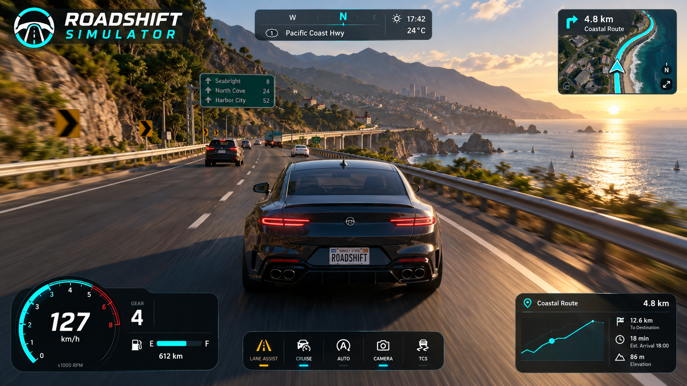
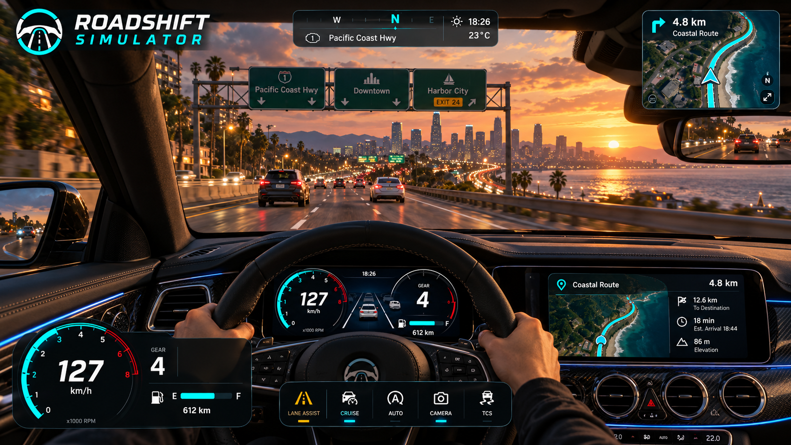
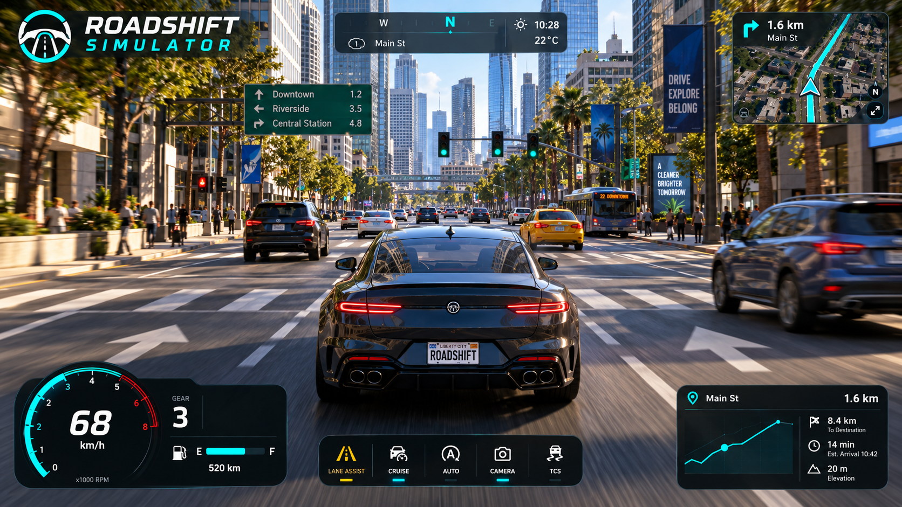
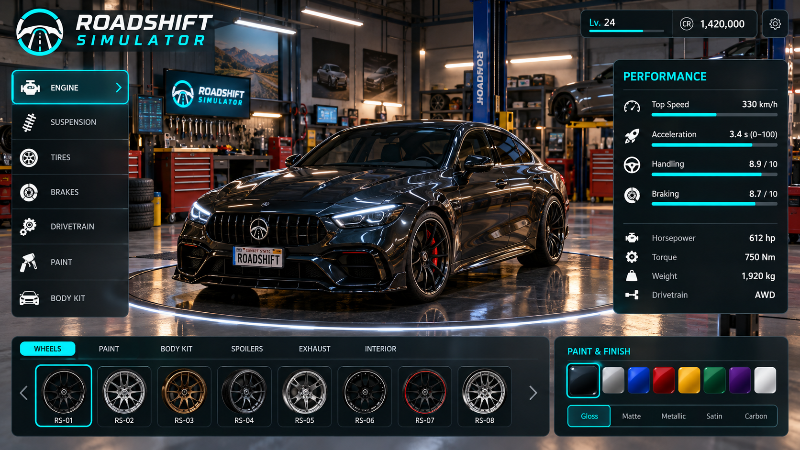
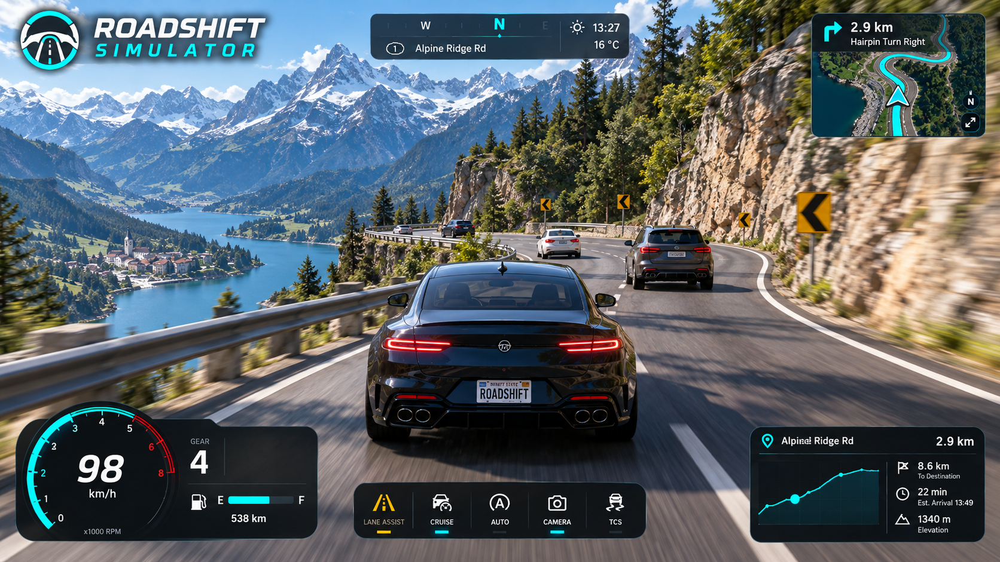

# Coastline Rush
Playable Three.js arcade racing game inspired by a coastal racing reference. Eight racers, three laps, chase/bonnet cameras, nitro, braking, offroad slowdown, car contact, leaderboard, lap times, minimap, and mobile buttons. Cars, road, buildings, mountains, and scenery use original procedural geometry. The art is stylized rather than photorealistic.

## Design reference gallery

Five user-supplied Roadshift Simulator visual concepts. These are design references, not screenshots of the implemented Coastline Rush game.

### Coastal highway

### Cockpit view

### City driving

### Garage and customization

### Alpine route

## Run
Node.js 22 or newer. Run `npm install`, then `npm run dev`. Open the local URL. `npm run build` produces static files in dist. Serve those files with an HTTP server; do not open index.html with file://.

## Controls
W/Up accelerate, S/Down brake, A/D or Left/Right steer, Shift nitro, C changes camera, Escape pauses. Touch buttons are shown on narrow screens. Pause and Restart buttons remain available. Collect the best race time in local browser storage when available.

## Gameplay
The arcade car follows a closed track and steers laterally. Crossing the start line after a full circuit advances the lap. Seven scripted rivals race independently. Road shoulders slow the car, and contact with rivals reduces speed. Finish after three laps; restart begins a fresh race. Distances and speed are arcade units, not a vehicle simulation.

## Validation
`npm test` runs nine race-rule tests. `npm run build` checks the production bundle. The optional Python Playwright check in tests/browser_check.py verifies rendering and controls; set CHROMIUM_PATH if needed. See docs/browser-report.json and actual rendered screenshots.

## Scope
Local single-player prototype, no online multiplayer, licensed vehicles, realistic handling, sound, or imported textures. Track motion is parameterized rather than free-roaming. Mobile layout and simulated pointer input are tested; physical iPhone/Android devices have not been tested.

## Commit history
Implementation commits record work done during this session, without backdating. artifacts/ThreeJS-Racing-Game.bundle preserves the original local commit identifiers alongside the imported GitHub history.
